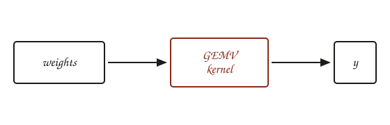

import Sidenote from '../../components/Sidenote.astro';

This is the first post on this site, and it doubles as its documentation. Publishing here means adding a single Markdown file to the `src/content/posts/` folder and pushing to GitHub — a GitHub Action builds the site and deploys it to GitHub Pages. Editing a post is the same loop: edit the file, push, done.

## Writing a post

Create `src/content/posts/my-post.md` (use `.mdx` instead of `.md` if you want sidenotes) with this frontmatter:

```yaml
---
title: My post title
date: 2026-07-21
tags: [some-topic, another]
draft: false
---
```

Drafts show up when you run `npm run dev` locally — marked with a small badge — but are excluded from the deployed site, so you can push half-finished work without publishing it.<Sidenote>The home page excerpt is generated automatically from the first paragraph of the post, so make that paragraph earn its place.</Sidenote>

## Sidenotes

Instead of footnotes at the bottom of the page, notes live in the margin next to the text they refer to.<Sidenote>Like this one. On a wide screen it sits in the right margin; on a narrow screen it stays hidden until you tap the little superscript number.</Sidenote> To use them, write the post as `.mdx`, import the component at the top of the file, and drop it inline where the note belongs:

```mdx
import Sidenote from '../../components/Sidenote.astro';

A claim worth qualifying<Sidenote>The qualification.</Sidenote> in the middle of a sentence.
```

## Math

LaTeX works in both `.md` and `.mdx` posts — inline with single dollars ($e_t^T$ renders inline) and display math with double dollars:

$$
S_t = \alpha_t S_{t-1} + \beta_t k_t e_t^T
$$

Just type the dollars; KaTeX renders it at build time, no client-side JavaScript.

## Diagrams (Excalidraw)

Draw at [excalidraw.com](https://excalidraw.com), then **export as SVG** (menu → Export image → SVG; tick "Embed scene" so the file stays editable later). Save it into `src/assets/diagrams/` and embed it with a normal, relative Markdown image:

```md

```


Relative paths matter — Astro rewrites them at build time so they keep working under the site's `/blog` prefix. Use PNG export instead if the diagram is huge.

That's the whole system. Write Markdown, push, and it's live.
