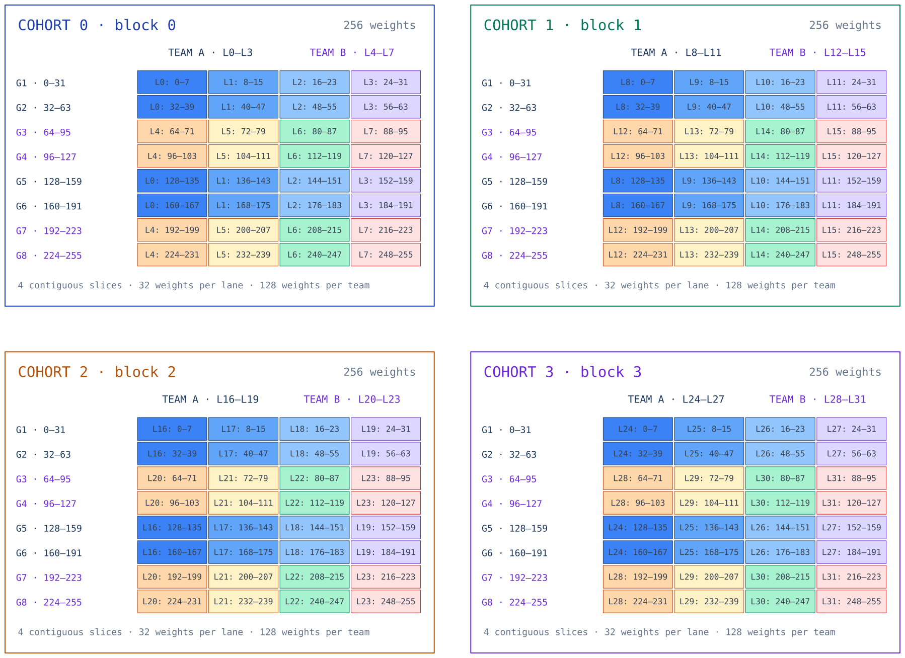

import Sidenote from '../../components/Sidenote.astro';

This is the main kernel
```c++
acc1[0] += yl[2 * i] * float(q1[i] & 0x000f);
acc1[1] += yl[2 * i + 1] * float(q1[i] & 0x0f00);
acc1[2] += yl[2 * i + 8] * float(q1[i] & 0x00f0);
acc1[3] += yl[2 * i + 9] * float(q1[i] & 0xf000);
acc2[0] += yh[2 * i] * float(q2[i] & 0x000f);
acc2[1] += yh[2 * i + 1] * float(q2[i] & 0x0f00);
acc2[2] += yh[2 * i + 8] * float(q2[i] & 0x00f0);
acc2[3] += yh[2 * i + 9] * float(q2[i] & 0xf000);
```

$$S_t = \alpha_t S_{t-1} + \beta_t k_t e_t^T$$



Instead of footnotes at the bottom of the page, notes live in the margin next to the text they refer to.<Sidenote>Like this one. On a wide screen it sits in the right margin; on a narrow screen it stays hidden until you tap the little superscript number.</Sidenote> To use them, write the post as `.mdx`, import the component at the top of the file, and drop it inline where the note belongs:
